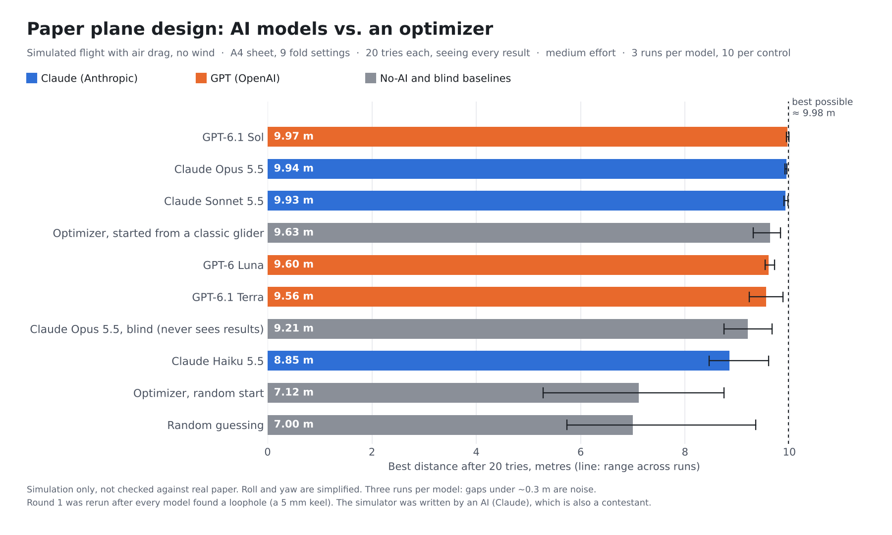

# Paper Plane Bench

Six AI models get the same job: design a paper plane, see how far it flies in a physics simulator, and try again. Each model gets 20 tries.



**Early results from a simulation only.** The planes have not been folded or thrown for real.

## The test

- **The sheet:** one A4 sheet (210 × 297 mm, about 5 g). Folding only, no cutting.
- **What a model controls:** 9 fold settings: nose folds, nose tip fold, keel depth at the front and back, wingtip fins, a tail flap (size and angle), and the wing angle (dihedral). See `PARAMS` in [`plane.py`](plane.py).
- **The throw:** the same every time. 6 m/s from 1.8 m high, aimed 5° up, no wind. Each attempt is thrown 5 times with the same 5 small hand wobbles, and it scores the median distance.
- **Feedback:** after each try the model sees the distance, its best so far, and a flight log (stalled, dived, rolled, looped).
- **Models:** Claude Opus 5.5, Sonnet 5.5 and Haiku 5.5 (through the Claude Code CLI), and GPT-6.1 Sol, GPT-6.1 Terra and GPT-6 Luna (through the Codex CLI). All ran at medium reasoning effort with no tools, 3 runs each. The prompt is `PROMPT` in [`agent.py`](agent.py).

## Baselines

- **Random guessing:** 20 random designs.
- **Optimizer, random start:** CMA-ES with 20 evaluations.
- **Optimizer, classic start:** the same CMA-ES started from a textbook glider.
- **Opus, blind:** Opus never sees any result, so it shows how much the feedback adds.

Each no-AI baseline ran 10 times.

## Results

Best distance after 20 tries, averaged over runs (with the range across runs):

| Player | After 5 | After 10 | After 20 |
|---|---|---|---|
| GPT-6.1 Sol | 7.61 | 8.87 | **9.97** (9.95–10.00) |
| Claude Opus 5.5 | 8.36 | 9.28 | **9.94** (9.92–9.95) |
| Claude Sonnet 5.5 | 9.39 | 9.80 | **9.93** (9.90–9.98) |
| GPT-6 Luna | 8.47 | 9.14 | 9.60 (9.54–9.72) |
| GPT-6.1 Terra | 8.76 | 9.15 | 9.56 (9.24–9.88) |
| Claude Haiku 5.5 | 6.84 | 8.01 | 8.85 (8.46–9.60) |
| Optimizer, classic start | 9.25 | 9.51 | 9.63 (9.31–9.83) |
| Opus, blind | 8.47 | 9.07 | 9.21 (8.75–9.67) |
| Optimizer, random start | 5.63 | 6.26 | 7.12 (5.28–8.75) |
| Random guessing | 6.17 | 6.63 | 7.00 (5.74–9.36) |

A long optimizer run (600 evaluations) tops out at about 9.98 m, which is the most this simulator allows.

What the results support:
- **The top three are tied.** Sol, Opus and Sonnet are all within 0.05 m of the maximum.
- **Sonnet learned fastest.** It passed 9 m by try 4 on average, compared with try 7 for Opus and try 12 for Sol.
- **Most of the advantage comes from prior knowledge.** The optimizer started from a classic glider beats three of the six models. Feedback added about 0.7 m for Opus.
- **They converged on one design:** a wide, basic glider with the keel at its minimum depth and a gentle upward bend at the back of the wings.

## Caveats

- **The simulator is simple.** Pitch is a full rigid-body simulation with drag, lift, stall and vortex lift. Roll is a one-line stability model, and yaw is not modelled. Treat it as a referee for a game, not a wind tunnel.
- **An AI (Claude) wrote the simulator,** and Claude models are also contestants.
- **Round 1 had a loophole.** With a 5 mm keel allowed, every model found that a nearly flat sheet glided about 10.5 m. I raised the minimum to 15 mm, since you need something to hold, and reran everything. The round-1 code is in [`round1/`](round1/).
- **The samples are small.** There are 3 runs per model, so gaps under about 0.3 m are noise.

## Files

- `plane.py`: the simulator (folding geometry, aerodynamics, flight). It needs only numpy.
- `agent.py`: runs one player for 20 tries and writes `results/<player>/runN.json`. Each attempt records the design, the model's one-line reason, the full result and the timing.
- `results/`: every attempt from round 2. `bests.json` holds each player's best design.
- `videos/`: one video per player showing its designs evolving, plus `race.mp4`, where every player's best plane is thrown together.
- `charts/`: the result charts. `render.py`, `video.py`, `charts.py` and `hero_chart.py` make them.

To reproduce a baseline and a score:

```
pip install -r requirements.txt
python3 agent.py random --runs 1
python3 -c "import plane, json; print(plane.evaluate(json.load(open('bests.json'))['gpt-6.1-sol']['design'])['distance'])"
```

To run the models, you need the `claude` and `codex` CLIs signed in. See the header of `agent.py`.

## Next

A round with wind, and more models.
